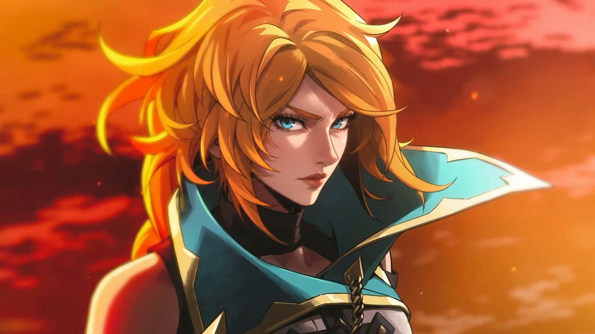
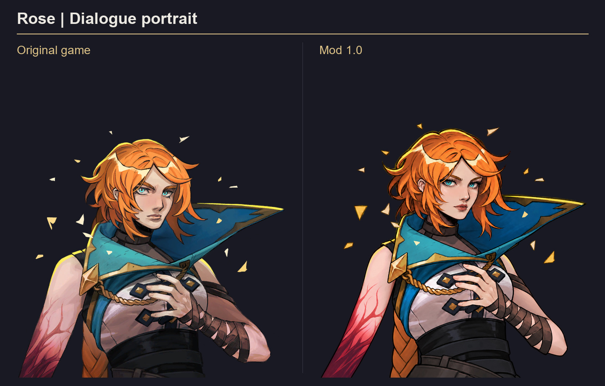
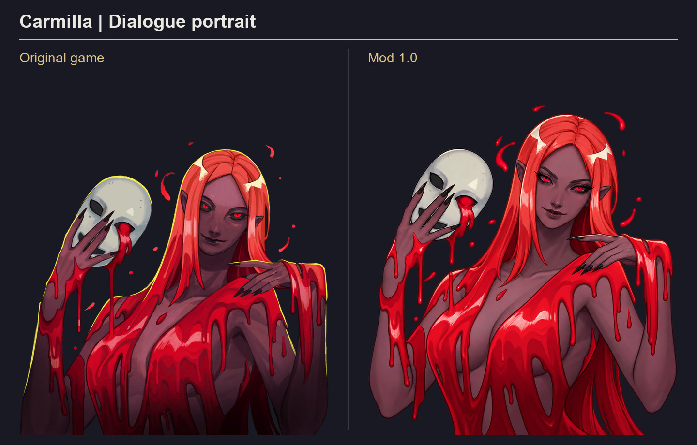
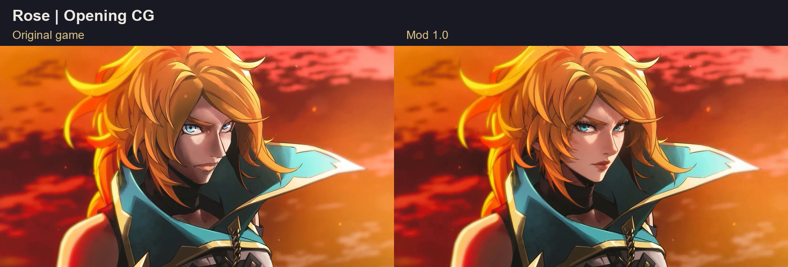

# Castlevania: Belmont's Curse — Feminine Artwork Mod

A visual mod that gives the female cast softer, more feminine illustrated designs and carries the facial refinements into the game's CG movies.



**Version 1.0 · Windows / Steam · Artwork and CGs**

[Download the mod](../../releases/latest) · [Installation](#installation) · [Portrait examples](#portrait-examples) · [CG example](#cg-example)

## What it changes

- **52 illustrated assets**, including dialogue portraits, speech icons, character cards, loading artwork, progress illustrations and outfit icons.
- Softer facial features and adjusted illustrated proportions, including narrower shoulders and slimmer arms where appropriate to each approved design.
- **Six CG movies at 720p, 1080p and 1440p**: 18 replacement video files in total. The CG changes focus on facial details to match the portrait direction, with localized tracking that preserves the original camera movement and frame edges.
- The original movie timing and both **English and Japanese audio tracks** are preserved.

The illustrated character set covers Rose and her doppelganger, Carmilla, Eleanor, Joan, Medusa, Succubus, Sypha and her alternate appearance, and the female spirit. Gameplay models, gameplay animations, combat and game balance retain their original files.

## Portrait examples

These comparisons use the original game artwork on the left and the final mod's portrait assets on the right. Both sides use the same scale and placement.

### Rose



### Carmilla



## CG example

Rose's opening CG, compared at the same moment. The mod example is a frame extracted from the finished replacement movie.



## Installation

1. Download **Castlevania-Feminine-Artwork-1.0.zip** from [Releases](../../releases/latest).
2. Extract the complete folder and close the game.
3. Open **Install Artwork Mod.cmd**.
4. Start the game normally through Steam.

The installer locates the game in your Steam libraries. If it cannot find a single installation, it asks you to paste the game folder path. You can also specify a location manually below.

<details>
<summary>Install to a different Steam library</summary>

Open PowerShell in the extracted mod folder and run the following, replacing the example path with your game folder:

```powershell
powershell.exe -NoProfile -ExecutionPolicy Bypass -File ".\ArtworkMod.ps1" -Action Install -GameDirectory "D:\SteamLibrary\steamapps\common\Castlevania Belmont's Curse"
```

For restoration at that location, use the same command with `-Action Restore`.

</details>

## Restore the original artwork

Close the game and open **Restore Original Artwork.cmd**. The installer retains verified originals in the game's **ArtworkModBackup** folder. Keep that folder until you have restored the game.

**Check Installation.cmd** checks whether the installed files still match the recorded installation.

## Compatibility and testing

Version 1.0 supports the exact Windows / Steam game files used to build this release. The installer verifies the original files before making changes and stops if an update or another mod has changed them. Mods that replace the same artwork or movie bundles will conflict.

- **Tested in game:** the opening movie, Rose's edited CG, the transition into the opening dialogue, and Rose's revised dialogue portrait.
- **Checked offline:** all rebuilt bundles, the original frame counts of all 18 edited videos, and the unchanged audio packets for both language tracks.
- Later character encounters, menus and ending scenes have **not** been played through in game.

## About

An unofficial fan-made visual mod, created with AI-assisted artwork edits and manual asset preparation, compositing and testing. Original characters, artwork and game assets belong to their respective rights holders. This project is not affiliated with or endorsed by the game's creators.

Pull requests are disabled for this repository.

